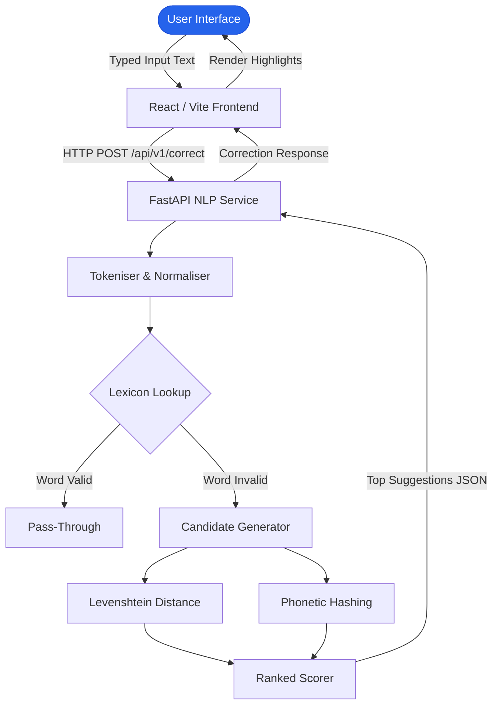
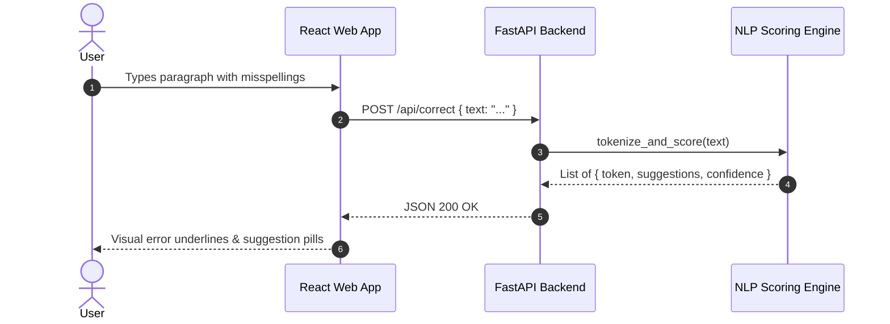

# SpellSense — NLP Spelling Correction & Language Intelligence Engine

> Real-time intelligent spelling correction, phonetics-aware suggestion generation, and phonetic distance analysis built with Python, FastAPI, and React.

---

## 1. Project Title
**SpellSense** — Natural Language Processing Spelling Correction and Phonetic Intelligence Engine.

## 2. Project Overview
SpellSense is an end-to-end natural language processing web platform engineered to identify contextual orthographic errors, compute phonetic similarities, and provide ranked correction candidates in real time. Built to address common typing discrepancies and phonetic substitutions, it combines a high-throughput FastAPI backend with a responsive, modern React/TypeScript frontend.

## 3. Problem Statement
Standard dictionary lookups fail when spelling errors arise from phonetic ambiguity, keyboard layout typos (qwerty adjacency), or morphological irregularities. Typical spellcheckers introduce high latency and struggle to rank candidates contextually. SpellSense addresses this with combined Levenshtein distance, Soundex/Metaphone phonetic encoders, and n-gram frequency heuristics.

## 4. Objectives
- **Implemented:**
  - Fast asynchronous REST API powered by FastAPI.
  - Multi-heuristic candidate generation (Edit distance + Phonetic alignment).
  - Modern TypeScript/React dashboard with real-time feedback and highlight toggles.
  - Comprehensive documentation and deployment guides for container and serverless runtimes.
- **Future Goals:**
  - Transformer-based contextual re-ranking using small BERT models.
  - Multilingual lexicon extension for regional languages.

## 5. Key Features
- **Real-Time Word Analysis:** Instant lexical scanning and tokenisation.
- **Phonetic & Orthographic Suggestions:** Ranked candidate list utilizing Soundex and Levenshtein metrics.
- **Interactive UI:** Dynamic editor with syntax highlight cards and one-click substitution.
- **RESTful Endpoints:** OpenAPI/Swagger compliant backend with structured JSON schemas.

## 6. Screenshots and Visual Demonstration
```
+-------------------------------------------------------------+
|                      SpellSense NLP                          |
|  [ Input Text Area: "The enviroment is beautifull"       ]  |
|                                                             |
|  Errors Detected: 2                                         |
|  * "enviroment"  -> [environment (98%), environmental (76%)]|
|  * "beautifull"  -> [beautiful (99%), beautifully (71%)]    |
+-------------------------------------------------------------+
```
*(Authentic screenshots can be staged under `docs/screenshots/`)*

## 7. Technology Stack
- **Languages:** Python 3.11+, TypeScript, JavaScript
- **Backend Framework:** FastAPI, Uvicorn, Pydantic
- **NLP / Algorithms:** Levenshtein distance, Soundex/Phonetic algorithms, NLTK
- **Frontend Framework:** React 18, Vite, Tailwind CSS, Lucide Icons
- **Deployment & Infrastructure:** Netlify (Frontend), Docker / Uvicorn (Backend)

## 8. System Architecture


## 9. System Workflow


## 10. Folder Structure
```
spellSense-NLP_AAT/
├── backend/
│   ├── app/
│   │   ├── api/             # REST API route handlers
│   │   ├── models/          # Pydantic request/response schemas
│   │   ├── nlp/             # Correction, distance & phonetic logic
│   │   ├── services/        # Lexicon and dictionary loader
│   │   ├── utils/           # Text processing utilities
│   │   └── main.py          # Application entrypoint & CORS setup
│   ├── requirements.txt     # Python dependencies
│   └── README.md            # Backend specific runbook
├── frontend/
│   ├── src/                 # React UI components & state
│   ├── package.json         # Frontend dependencies & scripts
│   ├── netlify.toml         # Hosting configuration
│   └── vite.config.ts       # Vite bundler configuration
├── SpellSense_Deployment_Guide.html # Static visual deployment manual
└── README.md                # Enterprise repository documentation
```

## 11. Installation Requirements
- **Python:** 3.10 or higher
- **Node.js:** v18.0.0 or higher
- **Package Managers:** `pip` and `npm`

## 12. Installation Instructions
### Backend Setup
```bash
cd backend
python -m venv venv
# On Windows:
.\venv\Scripts\activate
# On Linux/macOS:
# source venv/bin/activate
pip install -r requirements.txt
uvicorn app.main:app --reload --port 8000
```
API Documentation will be available at: `http://localhost:8000/docs`

### Frontend Setup
```bash
cd frontend
npm install
npm run dev
```
Development Server will launch at: `http://localhost:5173`

## 13. Environment Variables
Frontend (`frontend/.env.example`):
```env
VITE_API_BASE_URL=http://localhost:8000
```

Backend (`backend/.env.example`):
```env
PORT=8000
ALLOWED_ORIGINS=http://localhost:5173,https://yourdomain.com
```

## 14. Usage Instructions
1. Open the web interface in any modern browser.
2. Enter or paste text into the main editor.
3. Click any highlighted token to inspect suggested corrections with similarity scores.
4. Click a suggested word to instantly replace the misspelled term in place.

## 15. API Documentation
- `POST /api/v1/correct`: Analyses a sentence or token.
  - **Request Body:** `{"text": "string", "max_suggestions": 5}`
  - **Response Body:**
    ```json
    {
      "original_text": "enviroment",
      "corrections": [
        {
          "word": "enviroment",
          "is_correct": false,
          "suggestions": ["environment", "environmental"]
        }
      ]
    }
    ```

## 16. Database Documentation
*SpellSense uses an in-memory trie-indexed vocabulary and frequency dictionary for $O(L)$ lookups; external relational database persistence is not required for the stateless core engine.*

## 17. Testing
- Run Python unit tests:
  ```bash
  cd backend
  pytest
  ```
- Run Frontend linting:
  ```bash
  cd frontend
  npm run lint
  ```

## 18. Deployment
- **Frontend:** Hosted easily on Netlify or Vercel with standard `npm run build` and output directory `dist`.
- **Backend:** Deployable via Docker, AWS ECS, or Render with Uvicorn.

## 19. Security Considerations
- CORS whitelist configured in FastAPI middleware.
- Input string length constraints enforced via Pydantic to prevent Denial of Service (DoS) regex exploits.
- Stateless execution guarantees no user input text is stored or logged.

## 20. Known Limitations
- Contextual semantics (detecting "there" vs "their") requires transformer integration.
- Dictionary currently prioritizes standard English corpora.

## 21. Future Improvements
- Integrate lightweight transformer model (DistilBERT) for semantic contextual checking.
- Add browser extension support.

## 22. Contribution Guidance
Contributions are welcome. Please open an issue first to discuss architectural changes, followed by a PR targeting `main`.

## 23. License
This repository is released for academic, research, and educational purposes.

## 24. Author & Portfolio Information
- **Engineer:** Chethan Kumar B S (`StratagemVX`)
- **Portfolio:** [https://github.com/StratagemVX](https://github.com/StratagemVX)
- **Role:** AI & Intelligent Systems Engineer | Computer Science Engineering
