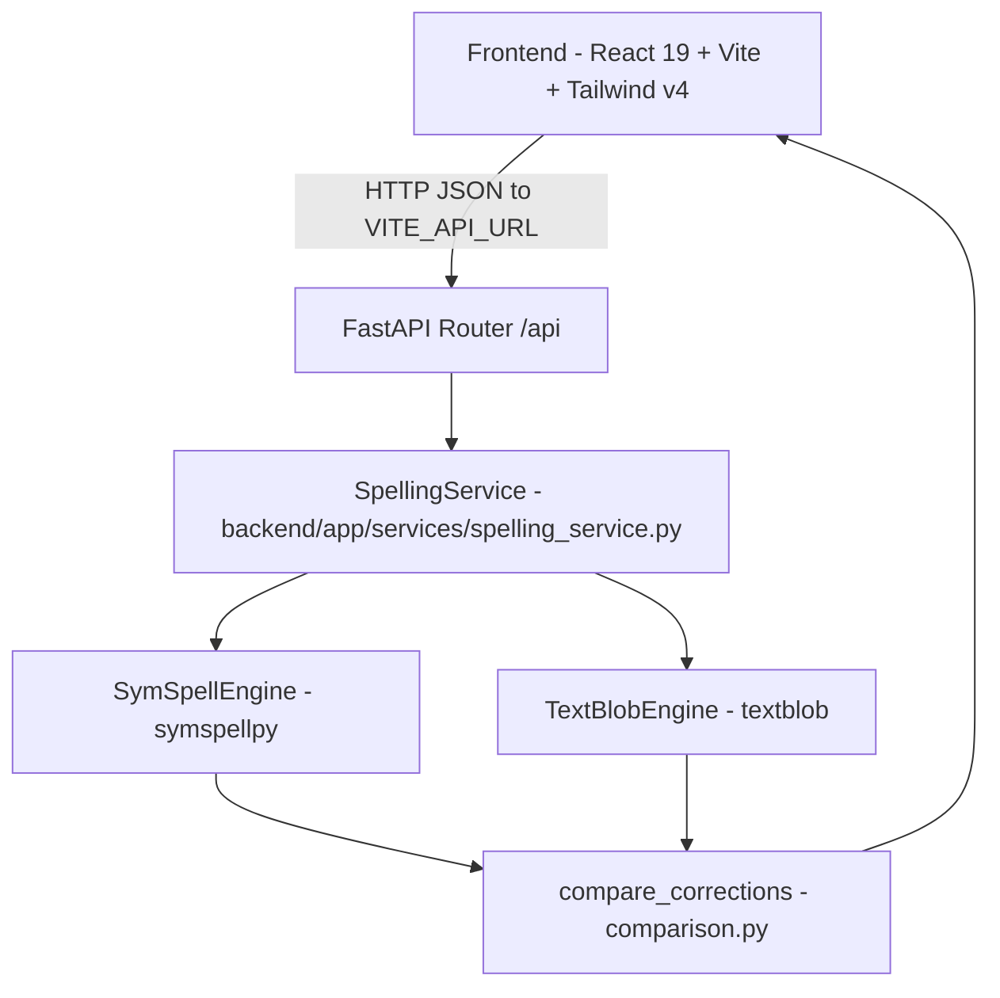

# SpellSense — Dual-Engine NLP Spelling Correction & Comparison Platform

> Full-stack spelling correction workbench built with FastAPI, SymSpell (`symspellpy`), TextBlob (`textblob`), and React 19 + TypeScript + Vite.

[](https://www.python.org/)
[](https://fastapi.tiangolo.com/)
[](https://react.dev/)
[](https://www.typescriptlang.org/)

---

## Executive Overview

**SpellSense** (`spellSense-NLP_AAT`) is an NLP spelling correction and algorithm-comparison application pairing a Python **FastAPI** backend with a **React + TypeScript + Tailwind CSS v4** educational studio. Rather than treating spellchecking as a black box, SpellSense runs both **SymSpell** (symmetric delete edit-distance indexing over `symspellpy`'s English frequency and bigram dictionaries) and **TextBlob** side by side, resolves disagreements via candidate intersection in `backend/app/nlp/comparison.py`, and explains token-level decisions, edit distances, and latency differences in the UI.

> **Branch & Security Status (`main` vs. Open Draft PR #4):**
> - Open Draft PR #4 (`maintenance/repository-quality-improvements`) hardens `backend/app/main.py` with strict `CORS_ALLOWED_ORIGINS` parsing (rejecting wildcard `*`), HTTP security headers (`X-Content-Type-Options`, `X-Frame-Options`, `Referrer-Policy`), generic 500 error responses that avoid leaking stack details, configurable `HOST`/`PORT`/`UVICORN_RELOAD`, placeholder `backend/.env.example` & `frontend/.env.example`, removal of tracked Python `__pycache__` bytecode, backend API/security unit tests (`backend/tests/test_app_security.py`), and `.github/workflows/quality.yml`.

---

## Implemented NLP Engines & Endpoints

### Backend NLP Engines (`backend/app/nlp/`)
- **SymSpell Engine (`symspell_engine.py`):** Loads `frequency_dictionary_en_82_765.txt` and `frequency_bigramdictionary_en_243_342.txt` from `symspellpy`, performing symmetric delete lookups (`max_dictionary_edit_distance=2`, `prefix_length=7`) with frequency/bigram ranking and caching.
- **TextBlob Engine (`textblob_engine.py`):** Uses `textblob.Word.spellcheck()` (backed by TextBlob/NLTK corpora) alongside SymSpell vocabulary fast-path checks.
- **Comparison Combiner (`comparison.py`):** Blends TextBlob and SymSpell token outputs (`compare` mode), detecting consensus, candidate-pool intersection, and speedup ratios.

### REST API Endpoints (`backend/app/api/endpoints.py`)
| Method & Path | Request Schema | Purpose |
|---|---|---|
| `POST /api/correct` | `{"text": "...", "algorithm": "compare" \| "textblob" \| "symspell"}` | Run dual-engine or single-engine text correction & statistics |
| `POST /api/correct/textblob` | `{"text": "..."}` | Correct text using TextBlob only |
| `POST /api/correct/symspell` | `{"text": "..."}` | Correct text using SymSpell only |
| `POST /api/analyze-word` | `{"word": "...", "max_edit_distance": 2}` | Inspect SymSpell deletes & candidate scoring for one token |
| `GET /api/examples` | — | Return preset sample sentences |
| `GET /api/health` | — | Readiness check reporting loaded SymSpell dictionary term count |
| `GET /docs` | — | FastAPI OpenAPI / Swagger UI |

---

## System Architecture



---

## Project Structure

```text
spellSense-NLP_AAT/
├── .github/workflows/quality.yml       # Backend unittest + frontend npm ci/audit/tsc/build (PR #4)
├── backend/
│   ├── app/
│   │   ├── api/endpoints.py            # /api/correct, /api/analyze-word, /api/examples, /api/health
│   │   ├── models/schemas.py           # Pydantic request/response contracts (<= 5000 chars)
│   │   ├── nlp/
│   │   │   ├── comparison.py           # TextBlob vs SymSpell consensus & statistics
│   │   │   ├── symspell_engine.py      # symspellpy loader, cache, candidate scoring
│   │   │   └── textblob_engine.py      # TextBlob spellcheck wrapper & cache
│   │   ├── services/spelling_service.py
│   │   ├── utils/text_utils.py         # Token offset splitter & casing preservation
│   │   └── main.py                     # FastAPI setup, CORS policy & exception handler
│   ├── tests/test_app_security.py      # Backend CORS, validation & API tests (PR #4)
│   ├── .env.example                    # HOST, PORT, CORS_ALLOWED_ORIGINS, UVICORN_RELOAD (PR #4)
│   ├── requirements.txt                # Pinned Python dependencies
│   └── README.md
├── frontend/
│   ├── src/
│   │   ├── components/                 # TextEditor, CorrectionResults, StatisticsPanel, SymSpellDeepDive, etc.
│   │   ├── pages/                      # HomePage, CorrectorPage, AlgorithmsPage, HowItWorksPage, ExamplesPage, AboutPage
│   │   ├── services/api.ts             # Fetch client targeting VITE_API_URL
│   │   ├── types/index.ts
│   │   └── App.tsx
│   ├── .env.example                    # VITE_API_URL placeholder (PR #4)
│   ├── netlify.toml
│   ├── vercel.json
│   └── package.json
├── SpellSense_Deployment_Guide.html
├── SpellSense_Deployment_Guide.pdf
└── README.md
```

---

## Setup, Environment & Verification

### Backend Setup & Tests
```bash
git clone https://github.com/StratagemVX/spellSense-NLP_AAT.git
cd spellSense-NLP_AAT/backend

python -m venv .venv
# Windows: .venv\Scripts\activate
# Linux/macOS: source .venv/bin/activate

pip install -r requirements.txt
python -c "import nltk; nltk.download('punkt'); nltk.download('brown')"
cp .env.example .env

# Run API server (default http://127.0.0.1:8000)
uvicorn app.main:app --port 8000

# Run backend security & API tests (PR #4)
PYTHONPATH=. python -m unittest discover -s tests -v
```

### Frontend Setup & Build (`frontend/package.json`)
```bash
cd ../frontend
npm ci --ignore-scripts
cp .env.example .env
npm run dev      # Dev server (http://localhost:5173)
```

| Frontend Command | Purpose |
|---|---|
| `npm run dev` | Start Vite dev server |
| `npm run build` | Run `tsc && vite build` |
| `npx tsc --noEmit` | Run strict TypeScript check (executed in CI `quality.yml`) |
| `npm run preview` | Preview built bundle |

### Environment Variables
- **Backend (`backend/.env.example`):** `HOST` (`127.0.0.1`), `PORT` (`8000`), `CORS_ALLOWED_ORIGINS` (comma-separated exact origins, `*` disallowed in PR #4), `UVICORN_RELOAD` (`false`).
- **Frontend (`frontend/.env.example`):** `VITE_API_URL` (`http://127.0.0.1:8000/api`).

---

## Known Limitations

- **Token-Level Context:** Both TextBlob `Word.spellcheck()` and single-word `SymSpell.lookup()` evaluate individual words rather than transformer-level sentence context, so valid homophones (e.g., *their* vs. *there*) are not flagged.
- **Open Repository PRs:** Draft PR #4 contains the security and CI hardening described above; earlier open PRs (#1, #2) also exist on GitHub for review/triage.

---

## Contributor Attribution & Profile

- **Lead Engineer:** Chethan Kumar B S (`StratagemVX`)
- **GitHub:** [https://github.com/StratagemVX](https://github.com/StratagemVX)
- **Portfolio:** [https://chethan-kumar-portfolio.vercel.app/](https://chethan-kumar-portfolio.vercel.app/)
- **LinkedIn:** [https://linkedin.com/in/chethan-kumar-b-s-781a002bb](https://linkedin.com/in/chethan-kumar-b-s-781a002bb)
