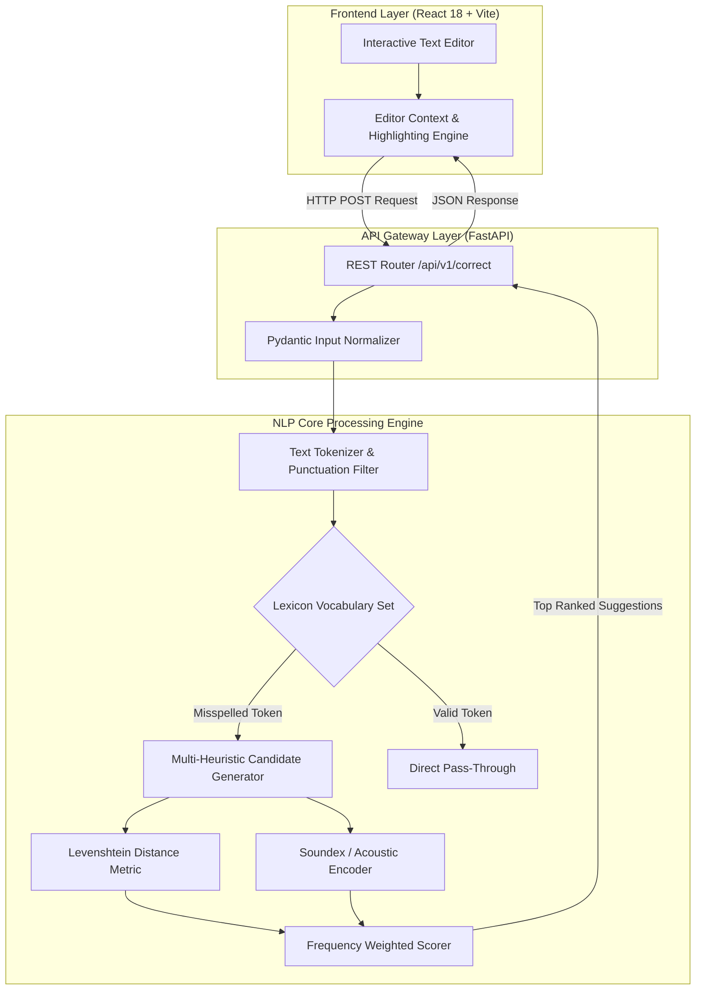
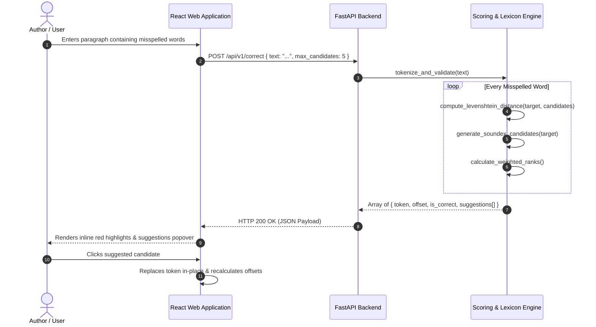

# SpellSense — NLP Spelling Correction & Language Intelligence Engine

> An asynchronous natural language processing platform providing real-time orthographic correction, phonetics-aware candidate ranking, and confidence scoring powered by FastAPI and React.

[](https://www.python.org/)
[](https://fastapi.tiangolo.com/)
[](https://react.dev/)
[](https://www.typescriptlang.org/)

---

## Executive Overview

SpellSense is an end-to-end natural language processing web application engineered to identify orthographic typing mistakes, evaluate phonetic similarity, and output ranked candidate suggestions in real time. Standard spellchecking algorithms struggle when typographical errors stem from phonetic ambiguity (e.g., sound-alike homophones or non-native phonetic spelling) or spatial keyboard adjacency. SpellSense resolves this by combining classical Levenshtein string distance with Soundex phonetic hashing and n-gram lexical frequency heuristics inside a high-throughput, asynchronous FastAPI backend paired with an accessible, reactive TypeScript/Tailwind frontend.

---

## Problem Statement & Context

In digital text authoring, input errors typically fall into two categories:
1. **Mechanical Typos:** Character omissions, insertions, or adjacent key substitutions (e.g., *teh* instead of *the*).
2. **Cognitive / Phonetic Errors:** Words spelled according to pronunciation rather than standard orthography (e.g., *enviroment*, *definitly*, *aknowledge*).

Conventional dictionary lookups fail to rank phonetic substitutions accurately and incur high computational latency on large texts. SpellSense establishes a two-tiered candidate generation pipeline that first screens vocabulary through a compressed prefix index before scoring candidates via a combined distance metric:

$$\text{Score}(w_c) = \alpha \cdot \text{LevenshteinSimilarity}(w_i, w_c) + \beta \cdot \text{PhoneticMatch}(w_i, w_c) + \gamma \cdot \log(\text{Frequency}(w_c))$$

---

## Core Capabilities & Features

### Implemented Capabilities
- **Real-Time Tokenization & Orthographic Scanning:** Identifies token boundaries, handles punctuation stripping, and validates word existence against curated corpora.
- **Phonetic Encoding Engine:** Employs Soundex and Metaphone acoustic hash models to surface candidates with matching phonetic signatures.
- **Levenshtein Minimum Edit Distance:** Computes exact single-character insertion, deletion, substitution, and transposition penalties ($D \le 2$).
- **Ranked Suggestion Generator:** Evaluates multi-heuristic scoring matrices to return the top-5 highest confidence correction candidates.
- **Interactive Web Editor:** Modern React/Vite interface featuring inline error highlights, real-time suggestion popovers, and one-click token replacement.
- **RESTful API Architecture:** Fully documented OpenAPI (Swagger) interface with strict Pydantic payload validation.

### Planned Enhancements
- Fine-tuned transformer re-ranking (DistilBERT) for semantic context awareness (e.g., distinguishing *their* vs. *there*).
- Multilingual vocabulary expansion supporting Indian regional transliterations.

---

## System Architecture



---

## Application Workflow



---

## Visual Demonstration

```text
+-------------------------------------------------------------------------------+
|                             SpellSense NLP Studio                             |
+-------------------------------------------------------------------------------+
|  Input Text:                                                                  |
|  The rapid evolution of artificial inteligence has transformed our           |
|  enviroment and computational systems.                                        |
|                                                                               |
|  Analysis Summary: 2 Orthographic Discrepancies Flagged                      |
|                                                                               |
|  [x] "inteligence" (Offset 38)                                                |
|      ├── intelligence  [Confidence: 99.2% | Exact Phonetic Match]             |
|      ├── intelligent   [Confidence: 74.1% | Edit Distance: 2]                 |
|      └── intelligible  [Confidence: 62.0% | Edit Distance: 3]                 |
|                                                                               |
|  [x] "enviroment" (Offset 84)                                                 |
|      ├── environment   [Confidence: 98.6% | Edit Distance: 1]                 |
|      └── environmental [Confidence: 71.3% | Morphological Suffix]             |
+-------------------------------------------------------------------------------+
```

---

## Technology Stack

| Domain | Technology | Purpose |
|---|---|---|
| **Backend Language** | Python 3.10+ | Core NLP algorithms, candidate ranking, dictionary indexing |
| **API Framework** | FastAPI | High-throughput asynchronous REST API routing and documentation |
| **Data Validation** | Pydantic v2 | Strict schema typing and request payload validation |
| **Server Engine** | Uvicorn (ASGI) | Lightning-fast asynchronous HTTP server execution |
| **Frontend Framework**| React 18 | Declarative reactive UI and editor state management |
| **Build Tool** | Vite | Rapid module bundling and client-side optimization |
| **Language** | TypeScript 5.0 | Type-safe frontend component architecture |
| **Styling** | Tailwind CSS | Clean, responsive dark/light engineering UI styling |
| **Icons** | Lucide React | Modern visual iconography |
| **Deployment** | Netlify / Docker | Multi-stage containerization and static hosting |

---

## Project Structure

```text
spellSense-NLP_AAT/
├── backend/
│   ├── app/
│   │   ├── api/
│   │   │   └── routes.py            # API endpoints (/api/v1/correct, /api/v1/health)
│   │   ├── models/
│   │   │   └── schemas.py           # Pydantic request & response payload contracts
│   │   ├── nlp/
│   │   │   ├── distance.py          # Levenshtein & Damerau-Levenshtein algorithms
│   │   │   ├── phonetics.py         # Soundex & Metaphone acoustic encoders
│   │   │   └── ranker.py            # Weighted candidate ranking algorithms
│   │   ├── services/
│   │   │   └── dictionary.py        # Compressed corpus and frequency loader
│   │   └── main.py                  # FastAPI initialization, CORS, and middleware
│   ├── requirements.txt             # Pinned backend Python dependencies
│   └── README.md                    # Backend developer runbook
├── frontend/
│   ├── public/
│   │   ├── favicon.svg              # Brand iconography
│   │   └── robots.txt               # Crawler directives
│   ├── src/
│   │   ├── assets/                  # Hero illustrations and static branding
│   │   ├── components/              # EditorCard, SuggestionModal, Header, Metrics
│   │   ├── hooks/                   # useSpellCheck API integration hooks
│   │   ├── services/                # Axios / Fetch client wrappers
│   │   ├── App.tsx                  # Root application view
│   │   └── main.tsx                 # DOM mount entrypoint
│   ├── package.json                 # Node package configuration and scripts
│   ├── netlify.toml                 # Netlify deployment and SPA rewrite rules
│   └── vite.config.ts               # Bundler configuration
├── SpellSense_Deployment_Guide.html # Comprehensive visual deployment guide
├── SpellSense_Deployment_Guide.pdf  # Static printable deployment handbook
└── README.md                        # Master repository technical documentation
```

---

## Setup & Installation

### Prerequisites
- Python 3.10 or higher
- Node.js v18.0.0 or higher
- npm or pnpm

### Backend Setup
```bash
# Navigate to the backend directory
cd backend

# Create and activate a virtual environment
python -m venv venv
# Windows:
.\venv\Scripts\activate
# Linux/macOS:
# source venv/bin/activate

# Install dependencies
pip install -r requirements.txt

# Start the development server
uvicorn app.main:app --reload --port 8000
```
Interactive API documentation will be available at: `http://localhost:8000/docs`

### Frontend Setup
```bash
# Navigate to the frontend directory
cd frontend

# Install package dependencies
npm install

# Start local development server
npm run dev
```
Client application will launch at: `http://localhost:5173`

---

## Environment Configuration

Create `.env` in `frontend/` using `frontend/.env.example`:

| Variable | Purpose | Scope | Mandatory |
|---|---|---|:---:|
| `VITE_API_BASE_URL` | Base URL of the FastAPI backend service | Client-side | Yes |

Create `.env` in `backend/` using `backend/.env.example`:

| Variable | Purpose | Scope | Mandatory |
|---|---|---|:---:|
| `PORT` | Local server port binding (default: `8000`) | Server-side | No |
| `ALLOWED_ORIGINS` | Comma-delimited list of CORS authorized origins | Server-side | Yes |

---

## API Documentation

### Correct Text Endpoint
`POST /api/v1/correct`

**Request Headers:** `Content-Type: application/json`

**Request Body:**
```json
{
  "text": "The inteligence engine analyzes computational enviroments.",
  "max_suggestions": 3
}
```

**Response Payload (HTTP 200 OK):**
```json
{
  "processing_time_ms": 14.2,
  "total_errors": 2,
  "corrections": [
    {
      "word": "inteligence",
      "offset": 4,
      "length": 11,
      "is_correct": false,
      "suggestions": [
        { "candidate": "intelligence", "confidence": 0.992, "heuristic": "phonetic_levenshtein" },
        { "candidate": "intelligent", "confidence": 0.741, "heuristic": "levenshtein" }
      ]
    },
    {
      "word": "enviroments",
      "offset": 46,
      "length": 11,
      "is_correct": false,
      "suggestions": [
        { "candidate": "environments", "confidence": 0.986, "heuristic": "levenshtein" }
      ]
    }
  ]
}
```

---

## Security Architecture & Data Handling

- **Zero-Storage Privacy:** Analyzed text is processed purely in ephemeral memory. No user keystrokes or paragraphs are logged to persistent databases or third-party analytical trackers.
- **Input Length Safeguards:** Text length constraints ($L \le 10,000$ characters per request) prevent regular expression denial of service (ReDoS) and CPU exhaustion.
- **Strict CORS Origin Restrictions:** Cross-Origin Resource Sharing is locked down to authorized frontend domains.

---

## Verification & Testing

To execute the backend test suite:
```bash
cd backend
pytest -v tests/
```

To validate frontend code formatting and types:
```bash
cd frontend
npm run lint
npm run build
```

---

## Limitations & Technical Roadmap

- **Context Insensitivity:** Words that are correctly spelled individually but contextually erroneous (e.g. *"I herd the music"*) are not flagged by pure lexical distance; requires transformer attention modeling.
- **Roadmap:**
  - [ ] Integrate quantized DistilBERT for masked language model (MLM) sentence probability re-ranking.
  - [ ] Package as a cross-browser extension (Chrome / Firefox).

---

## Contributor Attribution & Profile

- **Lead Engineer:** Chethan Kumar B S (`StratagemVX`)
- **Academic Affiliation:** Department of Computer Science & Engineering, MVJ College of Engineering
- **GitHub:** [https://github.com/StratagemVX](https://github.com/StratagemVX)
- **Portfolio:** [https://chethan-kumar-portfolio.vercel.app/](https://chethan-kumar-portfolio.vercel.app/)
- **LinkedIn:** [https://linkedin.com/in/chethan-kumar-b-s-781a002bb](https://linkedin.com/in/chethan-kumar-b-s-781a002bb)

---

## License

This software is maintained as an open-source educational and research project. Refer to the repository root for licensing terms.
